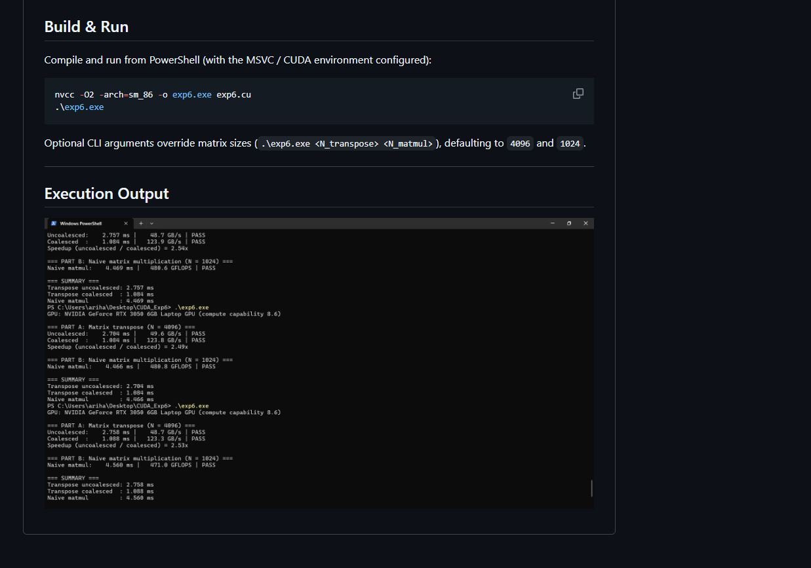

# Experiment 6 --- Memory Optimization in CUDA


A hands-on CUDA C++ experiment that explores how global-memory access
patterns and shared-memory tiling affect GPU performance. The program
compares two matrix-transpose implementations and measures a baseline
matrix-multiplication kernel.

------------------------------------------------------------------------

## Contents

-   [Objectives](#objectives)
-   [Workloads and kernels](#workloads-and-kernels)
-   [Hardware and software
    environment](#hardware-and-software-environment)
-   [Build and run](#build-and-run)
-   [Benchmark results](#benchmark-results)
-   [Concepts demonstrated](#concepts-demonstrated)
-   [Project structure](#project-structure)
-   [Execution screenshot](#execution-screenshot)

## Objectives

-   Understand how CUDA threads access global memory.
-   Compare coalesced and uncoalesced memory transactions.
-   Use shared memory to reorganize data during matrix transpose.
-   Understand shared-memory bank conflicts and padding.
-   Measure kernel execution time and validate computed results.

## Workloads and kernels

### 1. Matrix transpose

The transpose workload operates on an `N x N` matrix of `float` values.

**Naive transpose --- `transposeNaive`**

The baseline kernel reads matrix elements from global memory and writes
them to transposed positions. With the usual 2D thread mapping, one side
of the operation is contiguous across a warp while the other side is
strided. This can produce inefficient global-memory transactions.

**Shared-memory transpose --- `transposeCoalesced`**

The optimized kernel uses a `32 x 32` tile in shared memory to rearrange
elements before writing the transposed tile to global memory. The padded
declaration:

``` cpp
__shared__ float tile[32][33];
```

adds one extra column to the tile. This padding helps avoid the
shared-memory bank conflicts that can occur when a warp accesses a
column of a `32 x 32` tile.

### 2. Naive matrix multiplication

The `matMulNaive` kernel computes:

\[ C = A `\times `{=tex}B \]

Each CUDA thread computes one output element by accumulating products
across the inner dimension. This is a baseline implementation that
accesses input matrices from global memory. It is useful for comparison
with more advanced tiled matrix-multiplication approaches.

## Hardware and software environment

  Component              Specification
  ---------------------- ------------------------------------------------
  GPU                    NVIDIA GeForce RTX 5060 Ti
  Compute capability     12.0 (`sm_120`, Blackwell architecture)
  CUDA Toolkit           13.4
  Programming language   CUDA C++
  Operating system       Windows
  Compiler toolchain     NVIDIA `nvcc` with Microsoft Visual C++ (MSVC)

> **Note:** Record the exact driver version from `nvidia-smi` when
> documenting your final run. Benchmark results depend on the GPU,
> driver, clock state, power limit, matrix size, and system conditions.

## Build and run

Open an **x64 Native Tools Command Prompt for Visual Studio 2022** (or a
terminal where both MSVC and CUDA are available), then change to the
project directory.

Compile for the RTX 5060 Ti:

``` cmd
nvcc -O2 -arch=compute_120 -code=sm_120 -o exp6.exe exp6.cu
```

Run with the default matrix sizes:

``` cmd
exp6.exe
```

Or provide custom sizes:

``` cmd
exp6.exe 2048 512
```

The optional arguments are:

``` text
exp6.exe <N_transpose> <N_matmul>
```

-   `N_transpose`: dimension of the square matrix used for transpose.
-   `N_matmul`: dimension of the square matrices used for
    multiplication.

For example, `exp6.exe 2048 512` runs transpose on a `2048 x 2048`
matrix and matrix multiplication on `512 x 512` matrices, if the program
accepts these arguments as implemented in `exp6.cu`.

## Benchmark results

**Fill this table using the measurements printed by your own successful
run.** Do not copy results from another GPU or from a sample repository.

  --------------------------------------------------------------------------------------
  Kernel /          Matrix size Average time      Speedup      Throughput Verification
  workload                                                                
  ---------------- ------------ ------------ ------------ --------------- --------------
  Transpose ---      `N = ____`    `____ ms`      `1.00x`     `____ GB/s` `PASS/FAIL`
  naive /                                      (baseline)                 
  uncoalesced                                                             

  Transpose ---      `N = ____`    `____ ms`      `____x`     `____ GB/s` `PASS/FAIL`
  shared-memory /                                                         
  coalesced                                                               

  Matrix             `N = ____`    `____ ms`          ---   `____ GFLOPS` `PASS/FAIL`
  multiplication                                                          
  --- naive                                                               
  --------------------------------------------------------------------------------------

### How to interpret the measurements

-   **Speedup** compares the naive transpose time with the coalesced
    transpose time.
-   **Bandwidth** describes the effective data-transfer rate for the
    transpose workload. Use the same calculation and byte-count
    convention as the program.
-   **GFLOPS** reports billions of floating-point operations per second
    for matrix multiplication, based on the operation-count convention
    used by the program.
-   **Verification** indicates whether the GPU output passed the
    program's correctness check.

## Concepts demonstrated

-   **Global-memory coalescing:** Threads in a warp achieve more
    efficient memory transactions when their addresses are suitably
    contiguous.
-   **Shared-memory tiling:** A tile can be loaded in one access pattern
    and read back in another, allowing a transpose to use coalesced
    global-memory accesses on both sides.
-   **Shared-memory bank conflicts:** Multiple threads accessing
    different addresses in the same memory bank can cause conflicts.
    Padding a `32 x 32` tile to `32 x 33` changes the row stride and
    helps avoid the classic column-access conflict.
-   **Kernel timing:** CUDA events can measure GPU execution time.
    Warm-up launches and repeated measurements help produce more
    representative timings.
-   **Correctness checking:** Performance comparisons are meaningful
    only when the output is also validated.

## Project structure

``` text
PGC-L6-CUDA-Memory-Optimization/
├── exp6.cu
├── README.md
├── .gitignore
└── screenshots/
    └── output.png
```

Keep the screenshot inside the repository and reference it using a
relative path so it renders on GitHub.

## Execution screenshot

After a successful run, save a screenshot of the terminal output as
`screenshots/output.png`.



If your screenshot has a different filename, update the image path above
to match it.

------------------------------------------------------------------------

## Author / course information

-   **Course:** Parallel and GPU Computing
-   **Experiment:** 6 --- Memory Optimization in CUDA
-   **Implementation:** CUDA C++

Add your name, USN, class, and institution here if required by your lab
submission guidelines.
